# AD — manipulations sur les comptes et groupes (interface graphique)

> **Compte requis :** administrateur de domaine ou compte délégué autorisé à modifier les objets concernés. Les opérations se font dans `Utilisateurs et ordinateurs Active Directory` (`dsa.msc`), sur le DC ou un poste avec RSAT.

## 1. Créer un utilisateur

1. Ouvrir `Gestionnaire de serveur → Outils → Utilisateurs et ordinateurs Active Directory`.
2. Aller dans l'**OU cible** (ex. `RH`).
3. Clic droit → `Nouveau → Utilisateur`.
4. Renseigner nom, prénom et identifiant de connexion.
5. Saisir un mot de passe temporaire conforme à la politique du domaine.
6. Cocher `L'utilisateur doit changer le mot de passe à la prochaine ouverture de session` si demandé.
7. Terminer, puis vérifier que le compte apparaît dans la bonne OU.

**Pourquoi ?** Un compte **de domaine** est géré dans AD et peut s'authentifier sur les machines autorisées du domaine ; un compte **local** reste propre à une machine.

**Capture à faire :** assistant de création d'utilisateur dans la bonne OU.

### 📷 Captures correspondant à cette étape

**07 — creer utilisateur**

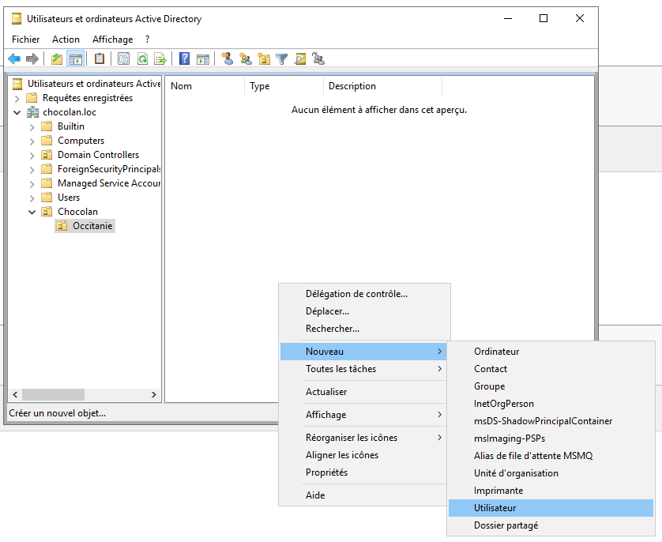

## 2. Modifier, désactiver, réactiver ou réinitialiser un compte

- **Propriétés** : double-clic sur l'utilisateur → modifier les champs demandés.
- **Réinitialiser le mot de passe** : clic droit sur le compte → `Réinitialiser le mot de passe`.
- **Désactiver** : clic droit → `Désactiver le compte` ; pour réactiver, `Activer le compte`.
- **Déverrouiller** après une politique de verrouillage : double-clic → onglet `Compte` → **Déverrouiller le compte** (lorsque l'option est proposée).
- **Forcer le changement de mot de passe** : propriétés → `Compte` → cocher `L'utilisateur doit changer le mot de passe`.

**Attention :** **activer** un compte désactivé et **déverrouiller** un compte verrouillé sont deux opérations différentes.

**Capture à faire :** onglet `Compte` avec les options de mot de passe/déverrouillage.

### PowerShell équivalent (si préféré)

~~~powershell
Get-ADUser jdupont -Properties Enabled,LockedOut
Disable-ADAccount jdupont
Enable-ADAccount jdupont
Unlock-ADAccount jdupont
Set-ADUser jdupont -ChangePasswordAtLogon $true
~~~

Exécuter **seulement** l'action demandée, pas toutes les commandes successivement.

### 📷 Captures correspondant à cette étape

**08 — modifier proprietes utilisateur**

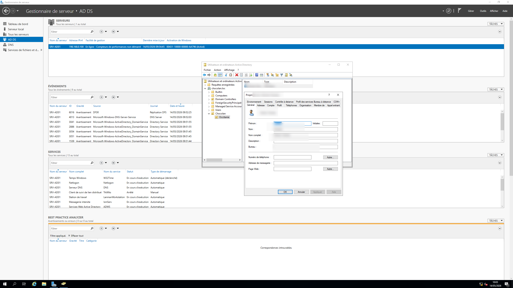

**09 — reinitialiser mot de passe**

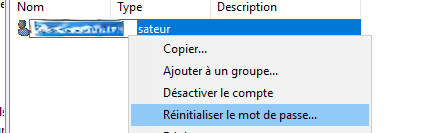

**10 — desactiver compte**

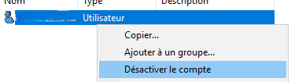

**11 — activer compte**

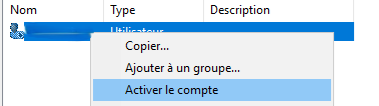

**12 — forcer changement mot de passe**

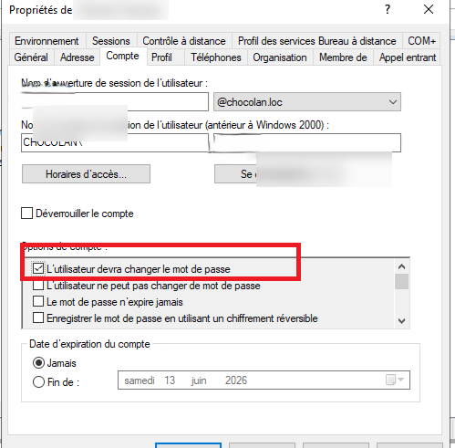

## 3. Définir horaires et expiration du compte

Double-clic sur l'utilisateur → onglet `Compte` :

- `Horaires d'accès` : choisir les plages autorisées pour la connexion.
- `Date d'expiration du compte` : choisir **Jamais** ou une **date de fin**, suivant l'énoncé.

**Captures à faire :** calendrier des horaires et date d'expiration.

### 📷 Captures correspondant à cette étape

**14 — horaires connexion**

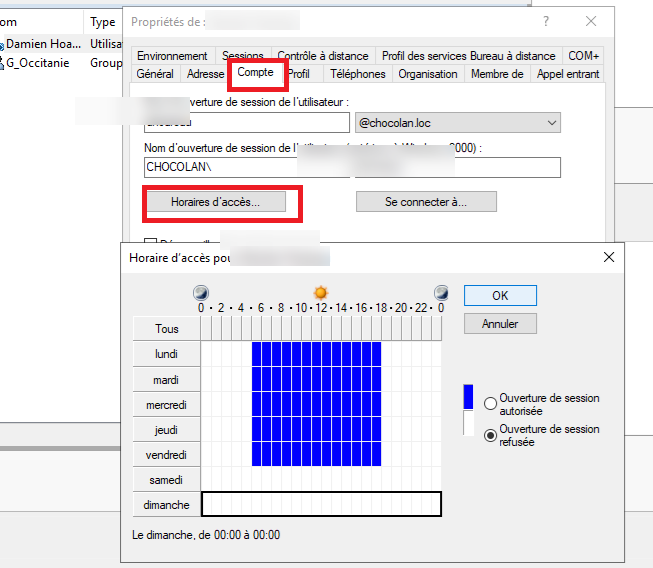

**15 — expiration compte**

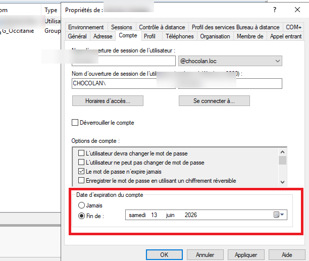

## 4. Créer un groupe, choisir sa portée, ajouter des membres

1. Dans l'OU : clic droit → `Nouveau → Groupe`.
2. Cocher **Sécurité**.
3. Choisir la portée : **Global**, **Domaine local** ou **Universel** selon le besoin.
4. Double-clic sur le groupe → `Membres → Ajouter` → vérifier les identifiants → valider.
5. Pour afficher les groupes d'un utilisateur : propriétés utilisateur → `Membre de`.

**AGDLP pour un partage :** Compte → Groupe **global** (`GG_RH`) → Groupe **local de domaine** (`GL_RH_RW`) → Permissions NTFS/SMB du dossier.

- **Global** : regrouper les comptes selon le service ou le métier.
- **Domaine local** : servir à attribuer les droits sur une ressource.
- **Universel** : utile pour regrouper des membres de plusieurs domaines d'une forêt selon les règles d'appartenance.

**Captures à faire :** création du groupe (type + portée), onglet `Membres`, onglet `Membre de`.

### Commandes pour vérifier

~~~powershell
Get-ADUser jdupont -Properties MemberOf
Get-ADPrincipalGroupMembership jdupont
Get-ADGroupMember GG_RH
Get-ADGroupMember GL_RH_RW
~~~

### 📷 Captures correspondant à cette étape

**13 — ajouter utilisateur groupe**

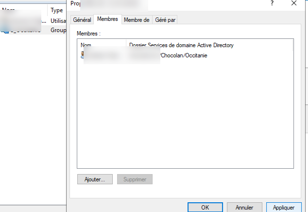

**28 — menu creer groupe**

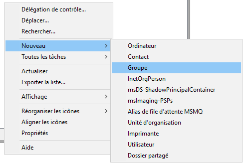

**29 — choisir portee groupe**

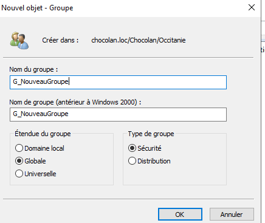

**30 — tableau portee groupes**

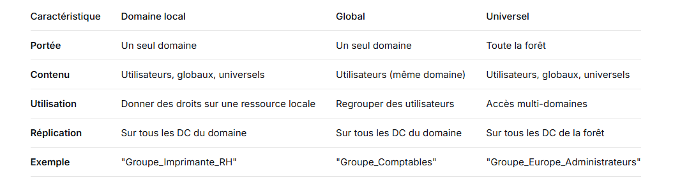

**31 — rappel groupes**

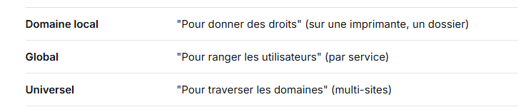

**32 — membre de**

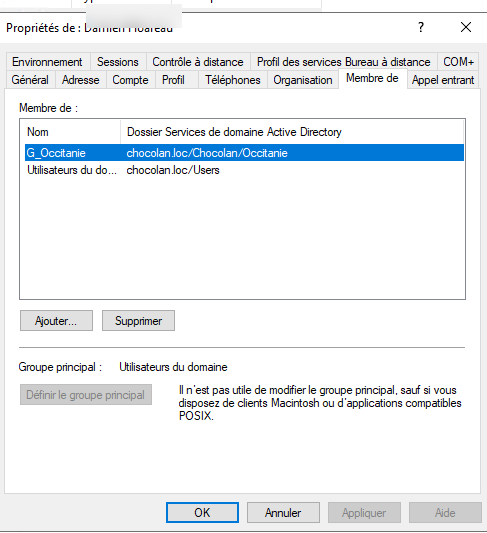

**33 — parametres groupe**

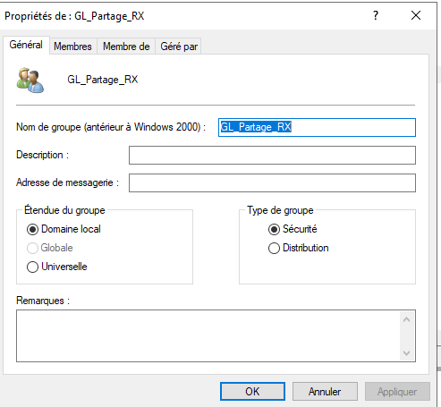

**34 — membres du groupe**

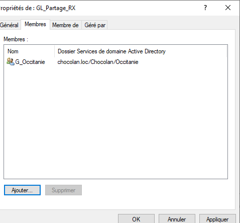

## 5. Tester réellement les droits

Sur un **poste client**, ouvrir une session avec le compte utilisateur, accéder au partage prévu et tenter **uniquement les opérations autorisées** (lecture, création, modification selon le sujet).

**Pourquoi ?** Voir un compte dans un groupe ne prouve pas que les droits du partage et les permissions NTFS ont été correctement attribués.

**Capture à faire :** accès au partage depuis le poste du compte cible.

### 📷 Captures correspondant à cette étape

**35 — tester acces partage**

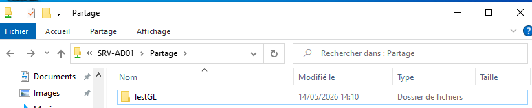

