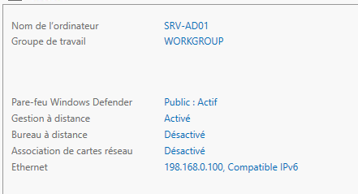
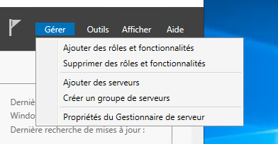
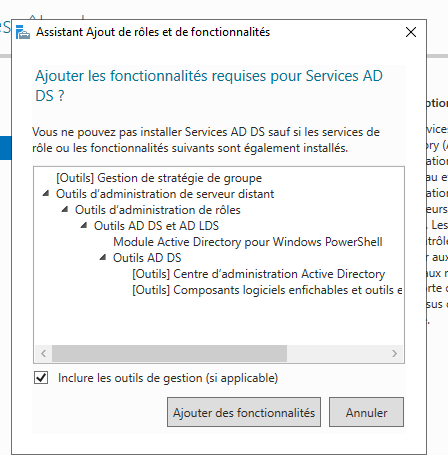
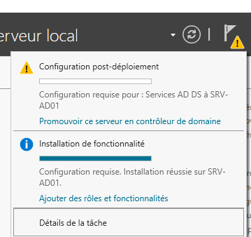
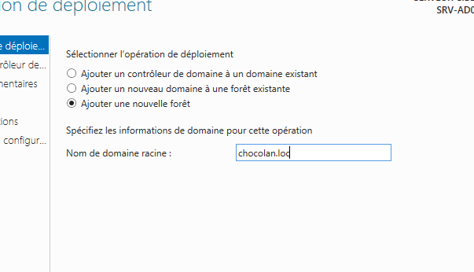
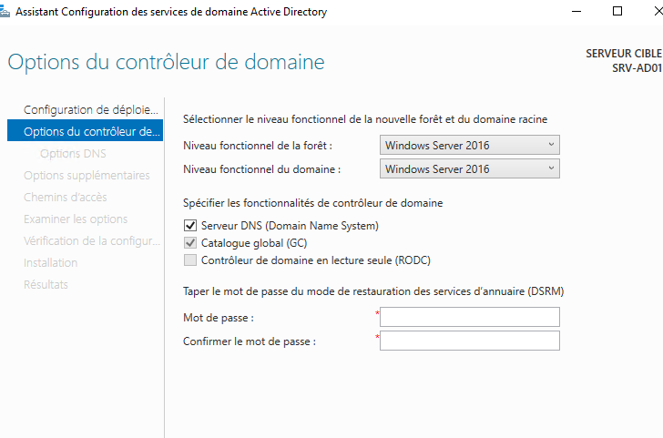

# Installer AD DS et créer un domaine — interface graphique

> **À utiliser uniquement si le sujet demande de créer un nouveau domaine/une nouvelle forêt.** Ne pas recréer un domaine si AD DS est déjà en place. Exemple fictif : serveur `SRV-AD01`, domaine `entreprise.local`, IP `192.168.10.10/24`.

## 1. Préparer le serveur

**Compte :** administrateur local du futur contrôleur de domaine.

1. Ouvrir `Gestionnaire de serveur → Serveur local`.
2. Renommer le serveur : `SRV-AD01`. Redémarrer si demandé.
3. Configurer une **IP fixe**, le masque, la passerelle et le DNS selon le sujet.
4. Pour un **premier DC qui assurera le DNS**, utiliser en général son adresse IP de service comme DNS préféré (ou le loopback demandé par l'exercice), pas un DNS public.

**Pourquoi ?** Les clients et le contrôleur de domaine doivent retrouver les enregistrements DNS Active Directory. Une IP de DC qui change rendrait la résolution et l'authentification instables.

**Capture personnelle utile :** « Serveur local » avec le nom de la machine et son IP.

### Vérifications possibles

~~~powershell
hostname
Get-NetIPConfiguration
Get-DnsClientServerAddress -AddressFamily IPv4
~~~

### 📷 Captures correspondant à cette étape

**01 — prerequis serveur**

## 2. Installer le rôle Active Directory

1. `Gestionnaire de serveur → Gérer → Ajouter des rôles et fonctionnalités`.
2. `Installation basée sur un rôle ou une fonctionnalité` → choisir le serveur.
3. Cocher `Services AD DS`.
4. Accepter `Ajouter des fonctionnalités` (outils de gestion).
5. Cliquer jusqu'à `Installer` et attendre la fin.

**Pourquoi ?** Le rôle installe les composants d'Active Directory. **L'installation du rôle ne transforme pas encore le serveur en DC.**

**Capture personnelle utile :** assistant avec `Services AD DS` sélectionné.

### 📷 Captures correspondant à cette étape

**02 — menu ajout roles**

**03 — dependances ad ds**

## 3. Promouvoir le serveur en contrôleur de domaine

1. Dans le Gestionnaire de serveur, cliquer sur le **drapeau de notification**.
2. `Promouvoir ce serveur en contrôleur de domaine`.
3. Pour un domaine entièrement nouveau : **Ajouter une nouvelle forêt**.
4. Renseigner le domaine racine, par exemple `entreprise.local`.
5. Dans `Options du contrôleur de domaine`, choisir le niveau fonctionnel **compatible avec le sujet et la version du système**.
6. Pour le premier DC, laisser **Serveur DNS** et **Catalogue global** cochés ; ne pas choisir **RODC**.
7. Définir et confirmer le mot de passe **DSRM** demandé (ne pas l'écrire dans GitHub).
8. Suivre les écrans **Options DNS**, **Nom NetBIOS**, **Chemins d'accès**, **Vérification des options**.
9. Lancer le **contrôle des prérequis**, corriger tout blocage, puis **Installer**.
10. Patienter pendant le redémarrage.

**Pourquoi ?** La promotion crée la base AD, la forêt, le domaine et (dans ce scénario) le service DNS nécessaire aux enregistrements du domaine.

**Captures personnelles utiles :** écran « Nouvelle forêt », « Options du contrôleur de domaine », puis écran final.

*Exemple : sélectionner « Ajouter une nouvelle forêt » puis renseigner le domaine racine.*

### 📷 Captures correspondant à cette étape

**04 — promotion controleur**

**05 — nouvelle foret**

**06 — options controleur**

## 4. Vérifier après redémarrage

Se connecter avec un **compte administrateur du domaine**.

~~~powershell
Get-ADDomain
Get-ADForest
Get-ADDomainController -Filter *
Get-Service NTDS,DNS
Resolve-DnsName -Type SRV _ldap._tcp.dc._msdcs.entreprise.local
~~~

Puis ouvrir `Outils → Utilisateurs et ordinateurs Active Directory` (`dsa.msc`) et `Outils → DNS` (`dnsmgmt.msc`).

**Résultat attendu :** domaine accessible, DC présent, services actifs, enregistrements SRV du domaine résolus.

## Si le sujet demande un **deuxième DC**, ce n'est pas la même opération

Lors de la promotion, choisir **Ajouter un contrôleur de domaine à un domaine existant**, utiliser des identifiants du domaine et vérifier la réplication à la fin :

~~~cmd
repadmin /replsummary
repadmin /showrepl
~~~

**Capture personnelle à préparer :** sélection de l'option « DC supplémentaire », différente de « Nouvelle forêt ».
