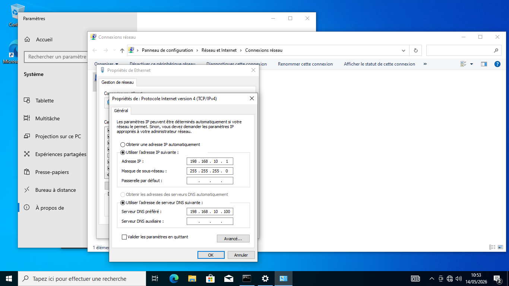
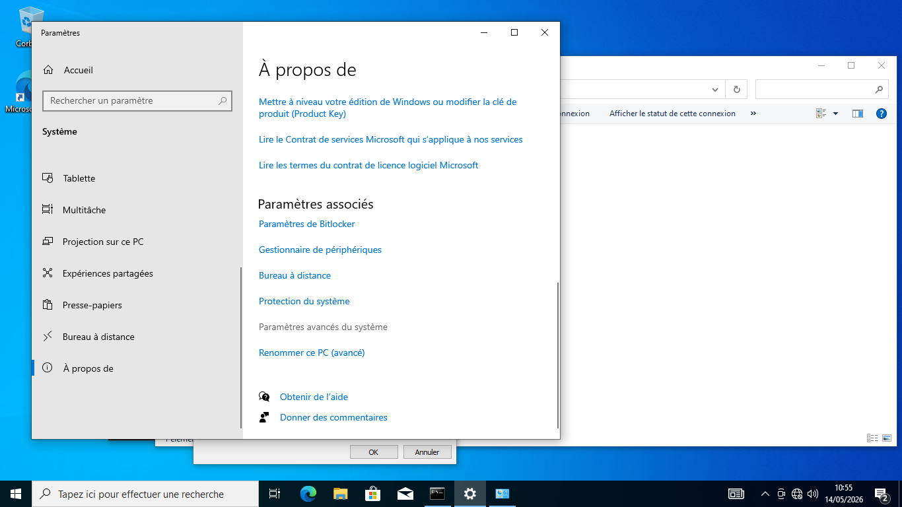
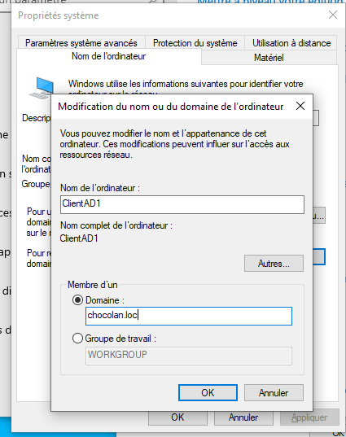
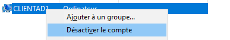
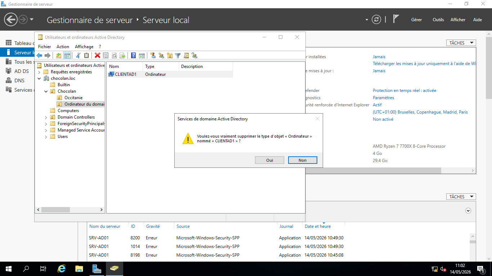
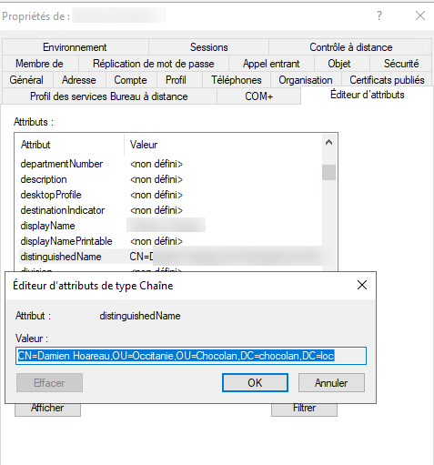
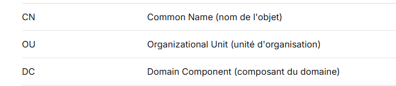
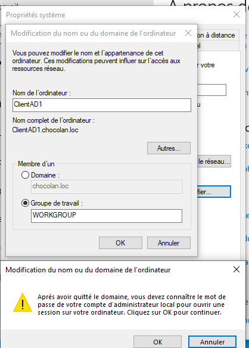
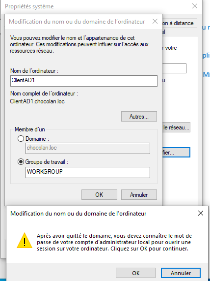

# AD — joindre un ordinateur, gérer les OU et retrouver un DN

> **Exemples fictifs :** domaine `entreprise.local` ; DC/DNS `192.168.10.10` ; client Windows avec une IP du même réseau ou avec un routage correct.

## 1. Joindre un poste Windows au domaine

**Sur le client :** se connecter avec un compte **administrateur local**, avoir le droit de joindre l'ordinateur au domaine et connaître les identifiants du domaine nécessaires à la jonction.

1. Vérifier **IP, masque, passerelle et DNS** du client.
2. Mettre comme DNS du client **le serveur DNS du domaine**, pas un DNS public.
3. Vérifier que le domaine est résolu.
4. Ouvrir `sysdm.cpl → Nom de l'ordinateur → Modifier`.
5. Cocher `Domaine` et saisir `entreprise.local`.
6. Entrer des identifiants autorisés lorsqu'ils sont demandés.
7. Valider le message de bienvenue et **redémarrer** le poste.

~~~cmd
ipconfig /all
nslookup entreprise.local
nslookup -type=SRV _ldap._tcp.dc._msdcs.entreprise.local
ping SRV-AD01
~~~

**Pourquoi ?** La jonction nécessite de découvrir un contrôleur de domaine à l'aide du DNS AD. Un DNS mal configuré est une cause fréquente d'échec.

**Captures personnelles utiles :** paramètres IP/DNS, fenêtre « Domaine », message de bienvenue.

### Vérifier après redémarrage

~~~powershell
Get-CimInstance Win32_ComputerSystem | Select-Object Name,Domain,PartOfDomain
~~~

Ouvrir une session avec un compte de domaine autorisé.

### 📷 Captures correspondant à cette étape

**36 — configurer dns client**

**37 — acces proprietes systeme**

**38 — joindre domaine**

## 2. Créer une OU et déplacer un objet

Depuis `dsa.msc` avec un **compte administrateur AD** :

1. Clic droit sur le domaine ou l'OU parente → `Nouveau → Unité d'organisation`.
2. Nommer l'OU (ex. `Postes`).
3. Cocher la protection contre la suppression accidentelle si proposée.
4. Repérer le poste dans `Computers` ou son OU actuelle.
5. Clic droit → `Déplacer` → choisir `Postes` (ou glisser-déposer si autorisé).
6. Vérifier que l'objet apparaît dans l'OU cible.

**Pourquoi ?** Les OU structurent les objets et permettent de cibler des GPO ; elles ne sont **pas** des groupes de permissions.

**Capture personnelle utile :** arborescence AD et poste dans l'OU cible.

## 3. Renommer, désactiver et supprimer un ordinateur

Dans `dsa.msc` : clic droit sur le **compte ordinateur** → options selon la manipulation demandée.

- **Désactiver le compte** : empêche normalement son authentification au domaine.
- **Réactiver** : restaure un compte désactivé.
- **Supprimer** : supprime l'objet AD (ne pas faire sans instruction).
- **Renommer** : pour modifier le nom réel de la machine, utiliser de préférence les outils du **poste client** (ex. `sysdm.cpl`), puis redémarrer et vérifier l'objet AD.

**Attention :** renommer **seulement** l'objet AD ne revient pas forcément à renommer correctement l'ordinateur Windows.

### 📷 Captures correspondant à cette étape

**39 — desactiver ordinateur**

**40 — console comptes ordinateurs**

## 4. Retrouver le DN d'un objet

Dans `dsa.msc` :

1. Menu `Affichage → Fonctionnalités avancées`.
2. Ouvrir les propriétés de l'utilisateur / ordinateur.
3. Onglet `Éditeur d'attributs` → attribut `distinguishedName`.

Exemple :

~~~text
CN=Jean Dupont,OU=RH,DC=entreprise,DC=local
~~~

- `CN` : nom commun de l'objet ;
- `OU` : unité d'organisation ;
- `DC` : composant du nom du domaine.

Alternative PowerShell :

~~~powershell
Get-ADUser jdupont | Select-Object Name,DistinguishedName
Get-ADComputer "CLIENT01" | Select-Object Name,DistinguishedName
~~~

**Capture personnelle utile :** onglet `Éditeur d'attributs` avec `distinguishedName`.

### 📷 Captures correspondant à cette étape

**43 — trouver distinguishedname**

**44 — cn ou dc rappel**

## 5. Quitter un domaine proprement (uniquement si demandé)

Avant de sortir le poste du domaine, **vérifier l'existence d'un compte administrateur local fonctionnel**. Dans `sysdm.cpl` → `Nom de l'ordinateur → Modifier`, choisir un groupe de travail, fournir les autorisations nécessaires puis redémarrer. Vérifier ensuite le compte ordinateur dans AD.

**Ne pas supprimer l'objet ordinateur ou quitter le domaine sans consigne.**

### 📷 Captures correspondant à cette étape

**41 — sortir du domaine**

**42 — confirmer sortie domaine**

