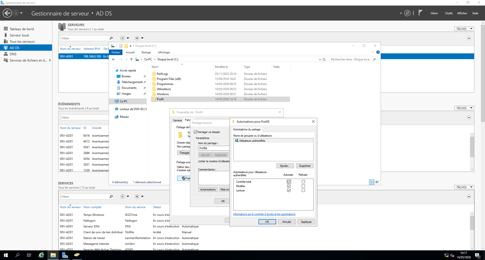
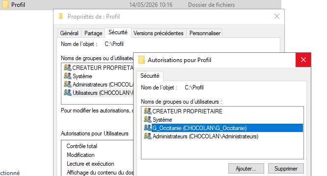
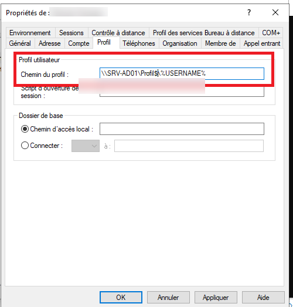
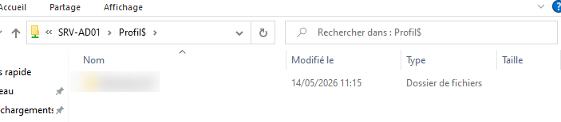
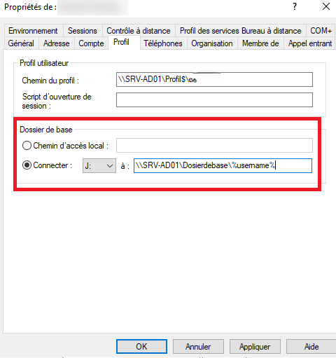
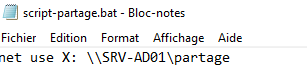
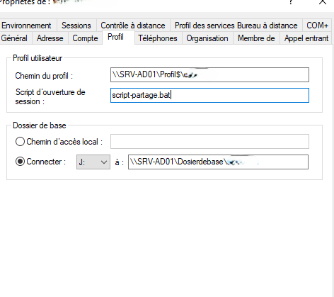

# AD — profil itinérant, dossier de base et script de connexion

> **Compte requis :** administrateur de domaine / droits délégués pour les propriétés AD ; droits d'administration du serveur de fichiers pour créer le partage. Exemples fictifs : serveur `SRV-FICHIERS`, utilisateur `jdupont`, domaine `ENTREPRISE`. Adapter les chemins et les autorisations.

## 1. Profil itinérant — ce qui est demandé

**Objectif :** stocker le profil de l'utilisateur sur un partage du serveur pour le retrouver sur différents postes compatibles.

**Prérequis :** un partage SMB dédié existe sur le serveur de fichiers (par exemple `Profils$`), avec **droits de partage et NTFS adaptés à la création du dossier personnel de chaque utilisateur**. La configuration des droits d'un partage de profils doit être soigneusement préparée : ne pas accorder par défaut un accès complet de tous les utilisateurs à tous les profils.

### Dans l'interface

1. Créer/configurer le dossier partagé sur le serveur.
2. Ouvrir `dsa.msc` et les **propriétés** de `jdupont`.
3. Aller dans l'onglet `Profil`.
4. Dans `Chemin du profil`, saisir par exemple :

~~~text
\\SRV-FICHIERS\Profils$\%username%
~~~

5. Valider.
6. Se connecter avec `jdupont` sur un poste client compatible et vérifier la création du profil sur le partage.

**Pourquoi ?** La variable `%username%` permet de construire un chemin différent pour chaque utilisateur. Windows peut ajouter un suffixe de version au répertoire du profil (ex. `.V6`), ce qui est normal selon la version du système.

**Captures personnelles utiles :** propriétés `Profil`, partage/permissions, dossier utilisateur créé sur le serveur.

### 📷 Captures correspondant à cette étape

**16 — creer partage profils**

**17 — droits ntfs profils**

**18 — chemin profil itinerant**

**19 — verification profil client**

## 2. Dossier de base (home folder) — **autre chose** qu'un profil itinérant

**Objectif :** disposer d'un dossier de travail personnel accessible via une lettre de lecteur.

**Prérequis :** un partage SMB (ex. `Dossiers$`) avec droits NTFS et SMB **isolant chaque utilisateur**.

Dans les **propriétés de l'utilisateur → Profil → Dossier de base** :

1. Choisir **Connecter**.
2. Sélectionner une lettre, ex. `H:`.
3. Saisir :

~~~text
\\SRV-FICHIERS\Dossiers$\%username%
~~~

4. Valider et tester la connexion avec ce compte sur le poste client.

**Pourquoi ?** Le dossier de base stocke des documents ; le **profil itinérant** concerne les données et paramètres du profil utilisateur. Il ne faut pas confondre les deux.

**Capture personnelle utile :** onglet `Profil` montrant la lettre du lecteur et le chemin UNC.

### 📷 Captures correspondant à cette étape

**20 — dossier base utilisateur**

## 3. Script d'ouverture de session pour connecter un partage

**Objectif :** mapper automatiquement un lecteur réseau lorsque l'utilisateur ouvre une session.

Sur un DC disposant des droits adaptés, repérer les scripts de connexion du domaine dans **SYSVOL**. Un accès classique est :

~~~text
\\entreprise.local\NETLOGON
~~~

Créer un fichier texte nommé `lecteur.bat` (attention à la vraie extension `.bat`) avec :

~~~bat
@echo off
net use X: \\SRV-FICHIERS\Partage /persistent:no
~~~

- `net use` : connecte le partage.
- `X:` : lettre à utiliser, si elle est libre.
- `/persistent:no` : évite une connexion permanente conservée par Windows.

**Ne pas inclure de mot de passe dans le script.**

Dans `dsa.msc` : propriétés de l'utilisateur → `Profil → Script d'ouverture de session` → renseigner **lecteur.bat** (et non le chemin complet si le script est dans l'emplacement NETLOGON prévu).

**Pourquoi ?** Le script est lancé dans la session de l'utilisateur et permet de monter automatiquement le lecteur.

**Captures personnelles utiles :** contenu du `.bat`, emplacement dans NETLOGON, propriété du compte, lecteur X visible sur le client.

### 📷 Captures correspondant à cette étape

**21 — sysvol scripts**

**22 — script lecteur bat**

**23 — attribution script session**

## 4. Vérifier depuis le client

~~~cmd
whoami
net use
dir X:\
~~~

Si `X:` n'existe pas : contrôler le chemin UNC, l'accès au partage, les droits de l'utilisateur, le nom du script et l'ouverture d'une **nouvelle session**.

> **Note pratique :** une GPO « Préférences → Mappages de lecteurs » est une autre manière de monter des lecteurs, mais cette fiche décrit la méthode par **script de connexion utilisateur** présentée dans le support.
