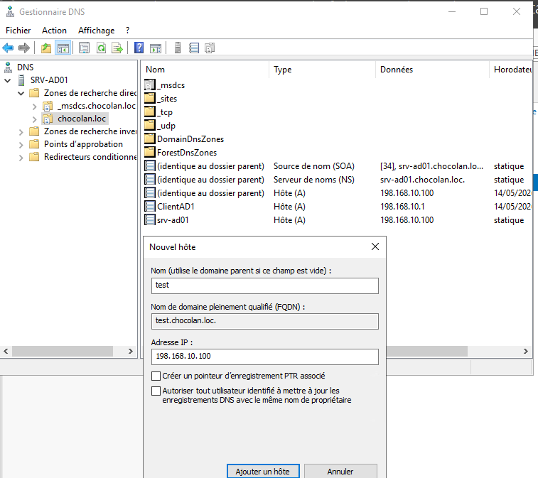
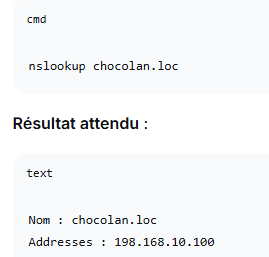
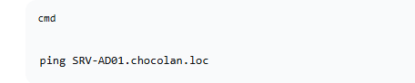

# DNS Windows Server — zones et enregistrements

## 1. Afficher les zones et enregistrements

~~~powershell
Get-DnsServerZone
Get-DnsServerResourceRecord -ZoneName "entreprise.local"
~~~

À exécuter sur un serveur DNS avec les outils DNS.

## 2. Créer une zone directe primaire classique (si demandé)

~~~powershell
Add-DnsServerPrimaryZone -Name "lab.example" -ZoneFile "lab.example.dns"
Get-DnsServerZone -Name "lab.example"
~~~

**Attention :** si le sujet utilise une zone déjà intégrée à Active Directory, ne pas recréer une zone concurrente. Pour une zone AD intégrée, la commande et les options de réplication diffèrent.

## 3. Créer un enregistrement A

~~~powershell
Add-DnsServerResourceRecordA -Name "web" -ZoneName "lab.example" -IPv4Address "192.168.10.20"
Resolve-DnsName web.lab.example
~~~

### 📷 Captures correspondant à cette étape

**48 — ajouter enregistrement dns**

## 4. Ajouter un alias CNAME

~~~powershell
Add-DnsServerResourceRecordCName -Name "intranet" -ZoneName "lab.example" -HostNameAlias "web.lab.example"
Resolve-DnsName intranet.lab.example
~~~

## 5. Créer une zone inversée IPv4 / PTR

~~~powershell
Add-DnsServerPrimaryZone -NetworkId "192.168.10.0/24" -ZoneFile "10.168.192.in-addr.arpa.dns"
Add-DnsServerResourceRecordPtr -Name "20" -ZoneName "10.168.192.in-addr.arpa" -PtrDomainName "web.lab.example"
Resolve-DnsName 192.168.10.20 -Type PTR
~~~

Adapter le réseau et éviter de recréer une zone inversée existante.

## 6. Interface graphique

`Gestionnaire de serveur → Outils → DNS` → Zones de recherche directes / inversées → nouvelle zone ou nouvel enregistrement **Hôte (A)**, **Alias (CNAME)** ou **Pointeur (PTR)**.

## 7. Tester côté client

~~~cmd
ipconfig /all
ipconfig /flushdns
nslookup web.lab.example
nslookup 192.168.10.20
~~~

`nslookup` peut cibler un serveur particulier : `nslookup web.lab.example 192.168.10.10`.

### 📷 Captures correspondant à cette étape

**45 — ping domaine**

**46 — nslookup domaine**

**47 — ping dc**

