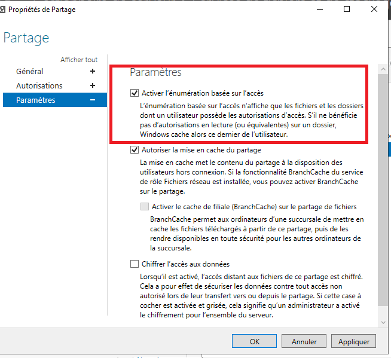
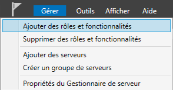
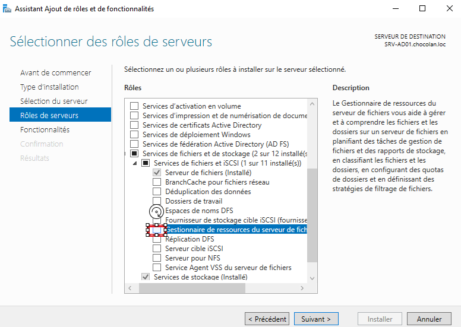
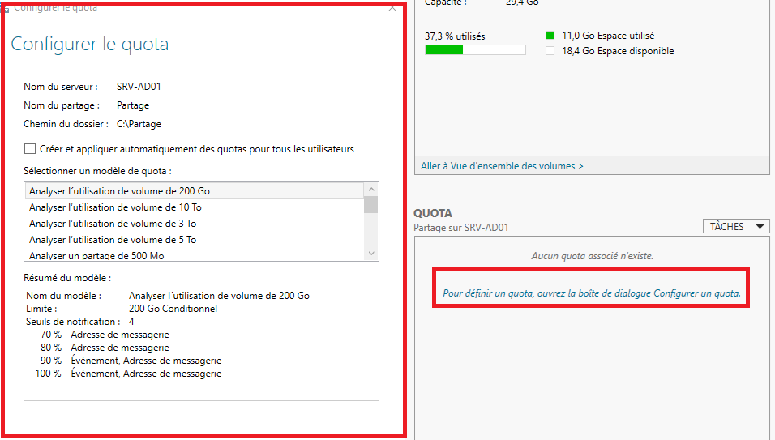

# Windows Server — énumération basée sur l'accès (ABE) et quotas FSRM

> **Compte requis :** compte administrateur du serveur de fichiers, ou compte délégué pour gérer les partages et quotas. Ne faire ces changements que sur les partages demandés.

## 1. Activer l'énumération basée sur l'accès (ABE)

**Objectif :** dans un partage SMB, masquer aux utilisateurs les dossiers pour lesquels ils n'ont **pas** les droits de consultation. L'ABE **n'accorde aucun droit** supplémentaire : les autorisations NTFS/SMB restent essentielles.

### Interface graphique

1. `Gestionnaire de serveur → Services de fichiers et de stockage → Partages`.
2. Sélectionner le partage ciblé, clic droit → `Propriétés`.
3. Ouvrir `Paramètres`.
4. Cocher **Activer l'énumération basée sur l'accès**.
5. Appliquer puis tester depuis le poste d'un utilisateur autorisé, puis d'un utilisateur non autorisé.

### PowerShell (alternatif)

~~~powershell
Get-SmbShare -Name RH | Select-Object Name,FolderEnumerationMode
Set-SmbShare -Name RH -FolderEnumerationMode AccessBased
Get-SmbShare -Name RH | Select-Object Name,FolderEnumerationMode
~~~

**Pourquoi ?** L'interface de l'utilisateur n'affichera pas les sous-dossiers qu'il n'a pas le droit de voir, sans remplacer la gestion des droits.

**Capture personnelle utile :** propriétés du partage, case ABE cochée.

### 📷 Captures correspondant à cette étape

**24 — enumeration basee acces**

## 2. Installer FSRM (si nécessaire)

**FSRM** = **File Server Resource Manager**, gestionnaire de ressources du serveur de fichiers.

Depuis `Gestionnaire de serveur → Gérer → Ajouter des rôles et fonctionnalités → Services de fichiers et de stockage → Services de fichiers et iSCSI`, sélectionner **Gestionnaire de ressources du serveur de fichiers**.

Alternative PowerShell :

~~~powershell
Install-WindowsFeature FS-Resource-Manager -IncludeManagementTools
~~~

**Pourquoi ?** Le rôle FSRM permet d'appliquer des quotas sur des dossiers/partages et de superviser leur utilisation.

**Capture personnelle utile :** rôle FSRM sélectionné dans l'assistant.

### 📷 Captures correspondant à cette étape

**25 — installer role fsrm**

**26 — selection fsrm**

## 3. Configurer un quota sur un dossier

Ouvrir `Outils → Gestionnaire de ressources du serveur de fichiers` :

1. `Gestion de quotas → Quotas`.
2. Cliquer sur **Créer un quota**.
3. Choisir le **chemin du dossier ciblé** (ex. `D:\Partages\RH`).
4. Choisir un modèle ou définir une limite personnalisée.
5. Définir la taille demandée (exemple fictif : **1 Go**).
6. Choisir **quota strict** (bloquant à la limite) ou **quota souple** (surveillance uniquement), **selon l'énoncé**.
7. Appliquer et contrôler que le quota apparaît dans la liste.

**Pourquoi ?** Un quota **strict** empêche de dépasser la limite ; un quota **souple** permet de suivre l'utilisation et d'émettre des alertes.

### PowerShell — exemple quota strict

~~~powershell
New-FsrmQuota -Path "D:\Partages\RH" -Size 1GB
Get-FsrmQuota -Path "D:\Partages\RH"
~~~

Ne pas exécuter si le quota existe déjà : dans ce cas, le modifier via l'interface ou avec les commandes FSRM adaptées.

**Captures personnelles utiles :** fenêtre « Créer un quota », taille choisie, liste de quotas et test côté utilisateur.

### 📷 Captures correspondant à cette étape

**27 — configuration quota**

## 4. Test final

- Se connecter avec un utilisateur ayant réellement accès au partage.
- Vérifier que l'ABE masque seulement les dossiers sans autorisation.
- Vérifier le quota configuré et son type ; si un test d'écriture est demandé, utiliser des fichiers de test **non sensibles** et rester dans l'espace prévu.

**À ne pas confondre :** ABE = visibilité des dossiers ; NTFS/SMB = contrôle d'accès ; FSRM = limites/contrôle de stockage.
