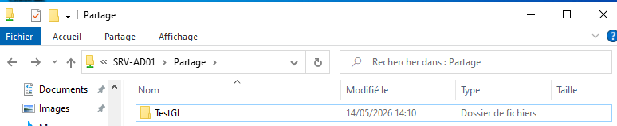

# Windows — partages SMB, droits NTFS et AGDLP

> Exemple : `D:\Partages\RH` partagé en `RH` ; groupe de domaine `ENTREPRISE\GL_RH_RW`. Adapter aux noms réels.

## 1. Créer le dossier

~~~powershell
New-Item -Path "D:\Partages\RH" -ItemType Directory -Force
~~~

Vérifier que le disque `D:` existe.

## 2. Créer le partage SMB

~~~powershell
New-SmbShare -Name "RH" -Path "D:\Partages\RH" -ChangeAccess "ENTREPRISE\GL_RH_RW"
Get-SmbShare -Name "RH"
Get-SmbShareAccess -Name "RH"
~~~

Remplacer `ENTREPRISE` par le nom NetBIOS réel du domaine. Éviter de supposer que les droits de partage et NTFS sont identiques.

## 3. Donner les droits NTFS (exemple : Modifier)

~~~cmd
icacls "D:\Partages\RH" /grant "ENTREPRISE\GL_RH_RW:(OI)(CI)M"
icacls "D:\Partages\RH"
~~~

- `(OI)` : héritage fichiers ;
- `(CI)` : héritage sous-dossiers ;
- `M` : Modifier ; `RX` : lecture/exécution ; `F` : contrôle total.

Conserver les autorisations nécessaires à `SYSTEM` et aux administrateurs ; ne pas désactiver l'héritage sans consigne.

## 4. Rappel AGDLP

**Utilisateur** → **GG_RH** (groupe global) → **GL_RH_RW** (groupe local de domaine) → **permissions sur le dossier**.

Les droits effectifs combinent les autorisations NTFS et de partage : l'accès réseau ne dépasse pas le plus restrictif des deux.

## 5. Interface graphique

- Dossier → **Propriétés → Partage → Partage avancé** ;
- **Autorisations** du partage ;
- Onglet **Sécurité** : permissions NTFS et groupes.

## 6. Tester depuis un poste client

~~~powershell
Test-Path "\\SRV-FICHIERS\RH"
net use Z: \\SRV-FICHIERS\RH
~~~

Tester avec **un vrai utilisateur membre** de `GG_RH` et vérifier lecture / création / modification selon le besoin.

## Compléments interface graphique

- [Activer l'énumération basée sur l'accès (ABE) et gérer les quotas FSRM](FSRM-Quotas-ABE.md)
- [Profils itinérants et dossiers de base sur un partage SMB](AD-Profils-Scripts.md)

### 📷 Captures correspondant à cette étape

**35 — tester acces partage**

